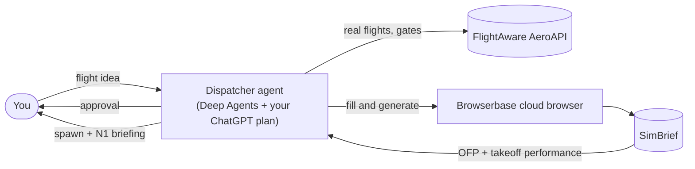

# Infinite Flight Agent

[](https://github.com/IntelIP/InfiniteFlightAgent/actions/workflows/ci.yml)
[](https://github.com/IntelIP/InfiniteFlightAgent/releases)
[](LICENSE)


**The open-source flight dispatcher for Infinite Flight pilots.**

Tell it the flight you want to fly, like *"Dulles to Denver tomorrow evening in the A321neo"*.
It finds a real airline flight, generates your SimBrief plan once you approve, and hands back a
briefing that starts with where to spawn and the takeoff N1 to set. It runs on your own keys and
your own ChatGPT plan, from the terminal or any MCP client.

[Get started](#get-started) · [Agent guide](docs/implementation/agent-usage.md) ·
[Self-host on Cloudflare](docs/implementation/deployment.md) ·
[Aircraft coverage](docs/aircraft-coverage.md) · [Changelog](CHANGELOG.md)

> **Early release (v0.2.0).** It works end to end locally and on the self-hosted Cloudflare
> deployment. Thrust targets are simulation-grade estimates. For flight simulation only: never
> use any output of this project for real-world flight planning or aircraft operation. See
> [status and limits](#status-and-limits).

## From flight idea to briefing

Infinite Flight Agent is for pilots who want to fly real-world schedules without assembling
them by hand: finding a flight that actually operates, filling in SimBrief, and working out
where to spawn and what thrust to set.

- **Fly real flights.** It searches live and recent schedules through
  [FlightAware AeroAPI](https://www.flightaware.com/commercial/aeroapi/) and never invents a
  flight number. If today's gate isn't assigned yet, it gives the gate from the most recent
  operation and labels it historical.
- **Approve before anything happens.** You see the exact flight, airports, departure time,
  connection, aircraft and thrust status before anything is generated or spent.
- **Get your SimBrief plan generated.** After you approve, it fills SimBrief's dispatch form
  in a cloud browser, reads every field back, and generates exactly one plan per leg.
- **Know your takeoff thrust.** N1 targets come from SimBrief's own takeoff solution and the
  lapse shape of FlyByWire's open A32NX thrust model, each with a range. Aircraft it can't
  model get a clear "unavailable" instead of a guess.
- **Plan whole trips.** Each leg of a multi-leg trip is dispatched and kept separately, and
  must leave at least 45 minutes after the previous leg lands.
- **Use it where you already chat.** Use the terminal chat, or connect ChatGPT, Claude or
  Codex to the MCP server.

## What you get

Every briefing leads with what you set first in the simulator:

| Part | What it tells you |
|---|---|
| Spawn | The gate FlightAware reports, or the most recent operation's gate labeled historical |
| Takeoff thrust | Thrust mode and an N1 target with its range, or "unavailable" and why |
| Flight | The real flight number, codeshares and aircraft, or your private callsign |
| Departure | Scheduled and estimated departure, in local time and UTC |
| SimBrief plan | Runways, aircraft and engine, cruise level, distance, time en route, block fuel and takeoff weight, confirmed against the generated plan |
| Takeoff | Runway, flaps, V-speeds and bleeds from SimBrief's takeoff performance |

```text
**SPAWN:** Gate C28 — used by the most recent completed UA599 (2026-10-30, FlightAware); today's gate is not assigned yet
**TAKEOFF THRUST (simulation-grade estimate):** FLEX, LEAP-1A32: set N1 0.911 x full-thrust N1 (range 0.865-0.948)

**Flight:** UA599 KIAD → KDEN · real aircraft A21N
**Departure:** sched out 2026-11-01 17:20 EST (2026-11-01T22:20:00Z)
**SimBrief plan confirmed:** KIAD 01R -> KDEN 16R · A21N LEAP-1A32 · FL360 · 1259 nm · ETE 03:27:38 · block fuel 11872 kgs
**Takeoff:** rwy 01R · flaps 1 · V1/VR/V2 155/159/161 · bleeds ON
```

<sub>A briefing from a live end-to-end run on October 31, 2026 (registration and codeshares removed).</sub>

## Get started

You need [uv](https://docs.astral.sh/uv/), a ChatGPT plan, a
[FlightAware AeroAPI](https://www.flightaware.com/commercial/aeroapi/) key (the Personal tier is
enough), a [SimBrief](https://www.simbrief.com) account with a Navigraph email and password, and
a [Browserbase](https://www.browserbase.com) API key.

```bash
git clone https://github.com/IntelIP/InfiniteFlightAgent.git
cd InfiniteFlightAgent
uv sync --locked
cp .env.example .env        # add AEROAPI_KEY, SIMBRIEF_USERID, BROWSERBASE_API_KEY,
                            # NAVIGRAPH_USERNAME and NAVIGRAPH_PASSWORD
uv run ifd-login            # sign in with ChatGPT and approve plan usage
uv run ifd-chat             # describe your flight
```

The cloud browser signs in to SimBrief by itself with your Navigraph email and password and
keeps that login between runs. If you sign in to Navigraph with Google, Apple or Microsoft, set a
Navigraph password first, or run `uv run ifd-simbrief` to sign in once by hand. Approval prompts
appear in the terminal. The [agent guide](docs/implementation/agent-usage.md) covers every
setting, resuming conversations, and MCP client setup.

## Ways to run it

| Path | Best for | Start |
|---|---|---|
| Terminal chat | Trying it out on one machine | `uv run ifd-chat` |
| Local MCP server | Claude Desktop, Codex or other MCP clients on your machine | [MCP setup](docs/implementation/simbrief-usage.md) |
| Self-hosted remote MCP | ChatGPT or your phone, behind Cloudflare Access | [Cloudflare deployment](docs/implementation/deployment.md) |

| Component | Local | Self-hosted on Cloudflare |
|---|---|---|
| Agent and MCP server | Your machine | A Cloudflare Worker and container, signed in through Cloudflare Access |
| Conversations and saved plans | SQLite in `data/` | Neon Postgres |
| Plan screenshots | `data/screens/` | Cloudflare R2 |
| Secrets | `.env` | Doppler, synced to Worker secrets on release |
| SimBrief login | Saved Browserbase profile | The same, refreshed by a daily keep-alive |

The self-hosted deployment is built for one owner. It is not a shared or resold service.

## How it works



One agent handles the conversation and the judgment calls. Fixed tools handle everything that
must be exact: flight lookup, the approval gate, plan generation, matching the generated plan
to its leg, and the thrust estimate. The approval gate refuses a dispatch you shouldn't be asked
to approve, such as a leg with no departure time or one that leaves before the previous leg
lands. See the [agent guide](docs/implementation/agent-usage.md) and the
[technical design](docs/technical-design.md).

## Quality

- **Evaluations.** The agent is checked against
  [100 scripted first messages](evals/dispatch_prompts.jsonl) in 11 categories, including
  vague requests, multi-leg trips, private flights and unsupported aircraft. On October 31,
  2026, two consecutive full runs passed every safety check and fully passed 92 and 91 of 100
  cases. The safety checks are: no invented flight numbers, no assumed dates, correct airports,
  and unsupported thrust disclosed before approval
  ([results](docs/implementation/agent-usage.md#full-100-case-runs--october-31-2026)).
- **No FlightAware fees for routine runs.** Evaluations replay synthetic or recorded FlightAware
  responses. Live provider checks are opt-in and capped at $1 per batch by default
  ([how to run them](evals/README.md)).
- **Live acceptance.** The Product validation check passes only while a recorded live run on
  the deployed code shows generation through MCP, a real neo plan, two legs kept separately,
  and an approval wait and resume ([evidence](docs/evidence/live-acceptance.json)).

## Releases

Versions follow [Semantic Versioning](https://semver.org). Every release has an entry in the
[changelog](CHANGELOG.md), a `vX.Y.Z` tag with a
[GitHub Release](https://github.com/IntelIP/InfiniteFlightAgent/releases), and a Cloudflare
Worker version with the same name. A running server reports its version at `/health`.

## Status and limits

- **Early, personal-use software.** It works end to end locally and on the self-hosted
  Cloudflare deployment, which planned its first live flights on November 1, 2026.
- **Thrust targets are simulation-grade estimates**, shown with a range. No aircraft is yet
  verified against reference data ([aircraft coverage](docs/aircraft-coverage.md)). The model
  covers airports from -2,000 to 2,000 ft pressure altitude, so high airports such as Denver
  get no N1 target.
- **FlightAware only sees about two days ahead.** Flights further out have no live schedule or
  gate.
- **It does not control the simulator.** It never claims your plan was imported, your aircraft
  spawned, or your thrust was set.

## Contributing

Issues and pull requests are welcome. Read [CONTRIBUTING.md](CONTRIBUTING.md) for setup, tests,
evaluation rules and live acceptance, and the [code of conduct](CODE_OF_CONDUCT.md). Checks that
need no provider keys:

```bash
uv run ruff check src tests
uv run pytest -q
```

Report vulnerabilities privately as described in [SECURITY.md](SECURITY.md). The
[roadmap](docs/roadmap.md) and [backlog](docs/backlog.md) show what's next.

## License

[GPL-3.0-only](LICENSE). The takeoff N1 estimator ports the thrust-limit lapse shape of
FlyByWire A32NX `ThrustLimits_A32NX.hpp` (GPL-3.0, commit `66021c2`), so the whole project is
distributed under the GPL. Bring your own keys and compute: no credentials, hosted service or
ChatGPT plan access are included.

Infinite Flight Agent is an independent project. It is not affiliated with or endorsed by
Infinite Flight LLC, FlightAware, SimBrief or Navigraph, Browserbase, OpenAI, or FlyByWire
Simulations. All trademarks belong to their owners.
