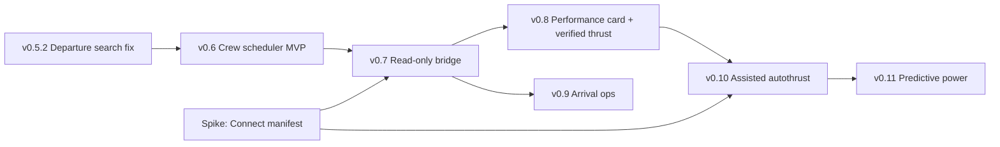

# Roadmap

Status updated November 13, 2026 UTC. Production is **v0.5.1**; its
[deployment record](implementation/deployment.md#current-release-v051) and
[release report](evidence/v051-release.md) own the observed release facts. Release work is
tracked in Linear as seven `IFA ·` projects under the "Infinite Flight Agent" project label, with
version milestones and target dates; the [Linear roadmap document](https://linear.app/intelip/document/infinite-flight-agent-roadmap-0dcea64227b8)
summarizes them.
The [backlog](backlog.md) indexes current capability and historical research;
[goal.md](goal.md) owns accepted intent and the aircraft-support definition.

## Vision

The agent tells you where to fly and why, then helps you fly it the way a real crew would.
It does this through three roles:

| Role | What it does | Where it runs | Status |
| --- | --- | --- | --- |
| **Crew scheduler** | Picks what to fly: real airline flights from your home hubs and preferred carriers, mixed with trips somewhere new, each with a one-line purpose ("First A350 into Addis") | Hosted agent (MCP tools on the existing Worker) | Not started |
| **Dispatcher** | Plans how to fly it: flight research, SimBrief plan, briefing, spawn and thrust guidance | Hosted agent | **Shipped** (v0.1–v0.5.1) |
| **Flight engineer** | Watches and, later, manages power and arrival in real time through Infinite Flight Connect API v2 | A small local companion program on the same network as the simulator | Not started |

### Design rules

1. **The model proposes, code verifies.** The LLM drafts schedules and performance plans;
   deterministic code enforces hard rules (rest, availability, fleet) and runs the control loop.
2. **No LLM in the control loop.** The agent computes the numbers before the flight; the
   local companion flies them in real time.
3. **Solo first.** Spawn anywhere, no aircraft repositioning, no Infinite Flight Live
   integration for now.
4. **Future schedules for planning, live status only at dispatch.** Live departure boards
   return roughly three-hour windows and hit HTTP 429, so they are unsuitable for building
   a schedule.

## What has shipped

| Area | Shipped capability | Versions | Still open |
| --- | --- | --- | --- |
| Dispatch | Dated FlightAware research, connection checks, reported gates, exact-input approval, SimBrief browser generation with SimBrief-chosen or agreed routes, retained multi-leg briefings, numbered revisions | v0.2–v0.4.7 | Cruise level and alternate inputs (INT-418); multi-airport departure search truncation and 429 |
| Trip control | Durable `trip_progress`, `cancel_trip`, 600 s turn deadline, restart recovery that never repeats Generate | v0.5.0, fixed in v0.5.1 | — |
| Thrust | Labeled A20N/A21N/B38M N1 estimates with exact engine identity and observed-N1 calibration | v0.3–v0.4.5 | **Zero aircraft verified**: simulator evidence missing (INT-412–414) |
| Aircraft catalog | Official v26 fleet matrix frozen: 51 current aircraft, 11 legacy | v0.4.4 | Per-aircraft references and simulator verification (INT-420–425) |
| Quality | 28-case whole-conversation MCP suite plus WF-029–033 trip-control suite in LangSmith; CI starts Playwright in the release image | v0.4.3–v0.5.1 | Client journeys and simulator import matrix (INT-426) |

| Version | User outcome | Owning acceptance |
| --- | --- | --- |
| v0.4.2 | Automatic routing, retained plans, bounded single-user browser workflows | [Deployment](implementation/deployment.md) |
| v0.4.3 | Useful revision validation; provider failures explain the cause; versioned evaluation baseline | [Evidence](evidence/v043-release.md); INT-402–406 |
| v0.4.4 | Predictable conversations and routing; v26 catalog matrix | [Evidence](evidence/v044-release.md); INT-407–411 |
| v0.4.5 | neo/MAX estimates enforce exact engine/condition identity; accuracy still unverified | [Evidence](evidence/v045-release.md); INT-415 |
| v0.4.6 | Numbered revisions generate and finalize in order | [Evidence](evidence/v046-release.md) |
| v0.4.7 | Generate is clicked directly; Route Finder no longer hangs generation | [Changelog](../CHANGELOG.md#047---2026-11-12) |
| v0.5.0 | Durable trip progress, cancellation and deadlines (INT-416/417). Broke generation; rolled back | [Report](evidence/v051-release.md) |
| v0.5.1 | Generation restored; CI checks the Playwright driver in the release image | [Report](evidence/v051-release.md) |

The rest of the original v0.5.0 milestone (INT-418–428) did not ship and is re-sequenced below.

## Priorities

Two facts drive the order:

- **The Connect API spike is the cheapest, most decisive step.** Whether the Connect manifest
  exposes N1 and OAT decides how the performance card, assisted autothrust and predictive
  power are designed. The same read-only telemetry is also the simulator evidence that every
  open thrust-verification ticket is waiting for. One evening with Infinite Flight running
  answers it, so it starts now, in parallel with the scheduler.
- **The scheduler needs only what the dispatcher already has.** It reuses FlightAware and the
  dispatch flow, so it can ship first and deliver the new "why this trip?" value while
  telemetry is being collected.

Arrival ops moves ahead of assisted autothrust. It is read-only, reuses the gate research the
dispatcher already does, and needs only live position from the bridge. Autothrust and
predictive power need calibrated per-aircraft engine models, which take many logged flights
to build. Arrival ops fills that calendar gap without control-write risk.

## Release plan

Versioning follows the existing policy: fixes ship as patches; each new capability is a minor.

| Version | Name | User outcome | Contents | Depends on |
| --- | --- | --- | --- | --- |
| **v0.5.2** | Departure search reliability | Multi-airport and 24-hour departure searches return complete results or say clearly what is missing | Page through boards instead of returning ~3-hour windows; back off and report on HTTP 429 (seen on KJFK) | — |
| **Spike** (no release) | Connect manifest | Known answers before phases 2–4 are designed | Dump the manifest for A20N, A21N and 77W; confirm N1, OAT, throttle read-back and AP speed/VS target writes; record in `docs/research/` | Hudson's device on the local network |
| **v0.6.0** | Crew scheduler MVP | "I have 4 hours" returns one real flight from a home hub, on a fleet aircraft, with a purpose line, ready to dispatch | Pilot profile (hubs, airline affinity, fleet, availability, regions); FlightAware `/schedules` with a cache; rules check in code; aircraft tiers in scoring; purpose generator (hub rotation, ~1-in-3 exploration, logbook gaps); manual "mark flown" logbook; hand-off to dispatch | v0.5.2 |
| **v0.7.0** | Read-only bridge | Flights log themselves, and every flight records the engine data needed to verify thrust | Local companion: Connect discovery and reads; automatic logbook (out/off/on/in), landing rate, flight-phase detection; N1/altitude/OAT/weight logs uploaded to the agent; checks that the imported plan matches the OFP (INT-426) | Spike, v0.6 |
| **v0.8.0** | Performance card | Before each flight: FLEX or derated N1, V-speeds, thrust reduction and acceleration altitudes, climb schedule and cruise level, with verified aircraft counted | Cruise level and alternate inputs (INT-418); per-aircraft reference scenarios (INT-420); first verified A20N/A21N/B38M from bridge logs (INT-412–414); thrust models for 77W, A35K, A339 (INT-422/423); measured coverage (INT-427) | v0.7 |
| **v0.9.0** | Arrival ops | A "company" message in descent with an assigned gate and an alternate, plus a taxi route on a companion map | FlightAware arrival gate when published, otherwise airline terminal and size-appropriate stand; OpenStreetMap taxiways and stands; text taxi instructions | v0.7 |
| **v0.10.0** | Assisted autothrust | The companion sets takeoff FLEX, CLB at thrust reduction and AP speed/VS by schedule; any manual throttle movement hands control back | Write-and-read-back confirmation for every set; opt-in per flight | Spike writes, v0.8 |
| **v0.11.0** | Predictive power | Planned N1 per segment, corrected live; step climbs, top of descent, approach speeds | Feed-forward from OFP winds, temperatures, levels and burn-off; PI correction on speed error; background re-plan only for large changes | v0.10, enough logged flights per aircraft |

**Later:** themed campaigns (Gulf carrier month, Caribbean island hopper), bid lines and trip
trades, live hooks (delays, new routes, new Infinite Flight aircraft), Infinite Flight Live API,
deadhead repositioning, the 787 after its cockpit rework, private-jet presets and Challenger
350/ACJ guidance (INT-419, INT-421), regional jets and the remaining fleet (INT-424, INT-425).

## Pilot profile (scheduler inputs)

- **Home hubs:** IAD, LAX, LHR, FRA, ACC
- **Airline affinity:** 1) US carriers, 2) Middle East, 3) European
- **Fleet = type ratings:** prefer interactive or refreshed cockpits (see aircraft tiers)
- **Availability:** real-time windows (weeknights, long weekends)
- **Regions to explore:** Latin America, South America, Caribbean, East Africa, Southeast Asia
- **Default mix:** mostly affinity carriers from home hubs, with exploration trips woven in

The monthly cycle is: build the schedule (reserve first; bid lines and trades later) → rules
check in code → dispatch (shipped) → fly it solo in real time → log it (manual in v0.6,
automatic in v0.7) → update pilot state → next assignment.

## Aircraft tiers (Infinite Flight 26.x)

| Tier | Aircraft | Best for | Thrust model |
| --- | --- | --- | --- |
| Interactive cockpit | A321neo (26.4), A320neo (26.5) | Short and medium haul | Estimate shipped; verification v0.8 |
| Refreshed cockpit (26.5) | 777, A350-900/-1000, A330 family, A380, 737 | Long haul (737 short haul) | B38M estimate shipped; 77W, A35K, A339 in v0.8 |
| Hold | 787 (not in the 26.5 refresh) | Swap in after its rework | — |

The scheduler assigns only aircraft in the pilot's fleet. Aircraft without a verified thrust
model can still be assigned; their briefing says so, as today.

## Connect API v2 facts

- **Transport:** TCP 10112 on the device's IP; UDP discovery on 15000; enable in Settings >
  General > "Enable Infinite Flight Connect". The companion must be on the simulator's network.
- **Reads:** position, ground speed, heading, on-ground, flaps, engine states, flight plan,
  wind at the current level.
- **Writes:** throttle (`simulator/throttle`; read-back returns the negated value), autopilot
  targets (for example `aircraft/0/systems/autopilot/spd/target`, m/s or Mach), flaps, toggle commands.
- **Limits:** writable states are not marked in the manifest; sets and commands are not
  confirmed (read back to verify); commands that need data are unusable
  (`FlightPlan.AddWaypoints`); reverse thrust is not controllable; the API cannot draw on
  Infinite Flight's map.
- **Unknown until the spike:** whether the manifest exposes N1 and OAT.

Control design for predictive power: feed-forward target N1 per segment (level, OAT/ISA
deviation, wind component, weight after burn-off); PI feedback on speed error, recomputed
locally when live wind or OAT diverges from forecast; the agent re-plans in the background
only for a new cruise level or reroute.

## Original product milestones

| Milestone | Current capability | Remaining acceptance | Now planned in |
| --- | --- | --- | --- |
| M0 — Integration feasibility | Generation, flight-data and hosted MCP paths run | Exact engine/profile applicability and simulator findings | Spike, v0.7 |
| M1 — Application foundation | Deep Agent, MCP, storage, CI, durable progress and cancellation | Client-specific journeys (INT-426) | v0.7 |
| M2 — Prepare a real flight collaboratively | Approval, generation, retained multi-leg briefings, evaluation suites | Simulator import and parking correspondence | v0.7, v0.9 |
| M3 — Launch-aircraft thrust guidance | Labeled estimates and calibration | Zero aircraft verified | v0.8 |
| M4 — Usable release | Remote MCP and deployment acceptance | Client journeys, import-field matrix | v0.7 |
| M5 — Aircraft expansion | v26 matrix frozen | Per-aircraft references and simulator verification | v0.8, then Later |

Shipping a version does not by itself complete these launch or aircraft-support criteria.

## Aircraft expansion

[INT-409](https://linear.app/intelip/issue/INT-409) froze the [official fleet and v26 matrix](research/aircraft-catalog-v26.md):
51 current aircraft and 11 legacy records. Strict majority is 26 fully verified current
entries; verified support is zero. Expansion now follows the aircraft tiers first, because
those are the aircraft the scheduler will assign. Partial support is reported separately and
never reduces the denominator. Numerical scenarios distinguish N1, EPR, torque and other
target types; no N1 formula is assumed universal. Cockpit or visual changes alone do not prove
a thrust-model change.

## Evaluation and release evidence

- Use whole-scenario and persistent-state checks in LangSmith, not only unit tests.
- Scheduler evaluations replay recorded or synthetic FlightAware schedule fixtures by default;
  live schedule calls are opt-in and cached.
- Keep scripted models, real-model replay, live-provider acceptance, numerical references,
  bridge telemetry and simulator observations as distinct evidence.
- Preserve exact-input approval, immutable retained plans, Generate claims, bounded browser
  ownership and explicit unavailable thrust.
- Control writes (v0.10+) need recorded read-back evidence and a demonstrated manual handback
  before release.

## Known issues

- Multi-airport 24-hour departure search returned truncated ~3-hour windows and an HTTP 429 on
  KJFK (2026-11-12/13 testing). Planned for v0.5.2.
- SimBrief timed out before the Generate click (`clicked: false`); fixed in v0.4.7. v0.5.0's
  generation failure is fixed in v0.5.1.

## Sources

- Connect API v2 docs: https://github.com/likeablegeek/ifc2docs
- Infinite Flight 26.5 (A320neo, cockpit retrofit): https://community.infiniteflight.com/t/infinite-flight-26-5-a320neo-and-fleetwide-cockpit-upgrades/1345775
- Infinite Flight 26.4 (A321neo, interactive cockpit): https://community.infiniteflight.com/t/infinite-flight-26-4/1291848
- Live API updates (free tier): https://community.infiniteflight.com/t/live-api-updates-march-2026/1166544
- Autopilot speed target: https://community.infiniteflight.com/t/autopilot-setspeed-can-only-be-changed-by-1-issue-in-connect-api/1276959
- Reverse thrust: https://community.infiniteflight.com/t/reverse-thrust-on-api/1277180
- Drag-and-taxi availability: https://community.infiniteflight.com/t/taxi-route-feature-question/904963
