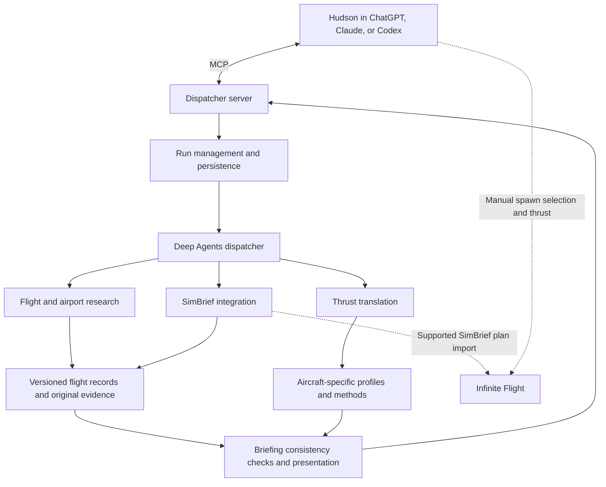

# Technical design

Status: proposed design, October 30, 2026. [Goal](goal.md) owns accepted product intent. [Backlog](backlog.md) owns unresolved decisions and work. No architecture described here has been implemented or live-validated.

Dependency findings: [SimBrief extension](research/simbrief-extension.md), [flight/gate sources](research/flight-data-sources.md), and [professional thrust sources](research/professional-thrust-sources.md). These reports own the source evidence and open access questions; the design below incorporates their implications.

Source selection follows the accepted [cost/operations preference](goal.md#cost-and-operations-preference--accepted-october-30-2026) and proposed [free-first strategy](research/free-first-strategy.md). Earlier paid-provider comparisons are fallback options, not selected dependencies.

## Architecture



The service exposes the dispatcher through MCP. The Deep Agent coordinates preparation behind that interface. The existing SimBrief MCP code is a reuse candidate for the internal integration; decide whether to wrap or incorporate it after source/license inspection. Do not force an internal network hop merely because the external interface is MCP.

Start with one coordinator and focused ordinary tools. The agent resolves incomplete requests, selects sources, handles exceptions, and explains results. Explicit code validates units, preserves identifiers, performs established numerical methods, enforces authority, and stores results. Skills describe procedure; they do not enforce permissions or replace working tools.

Deep Agents already uses LangGraph as runtime. Later explicit graph control can encode stable transitions without replacing useful adaptive research. A vector database, multi-agent hierarchy, and hosted queue are not required by current personal-use needs.

## Workflow and dependencies

1. Interpret an incomplete flight idea and gather material missing information with focused questions.
2. Resolve a dated airline flight/segment or a private itinerary. Research may occur before clarification when it helps establish valid options.
3. Establish intended simulator aircraft, configuration, weather, and time. These may differ from observed real-world conditions and must be recorded separately.
4. Research schedule, reported gate/terminal or FBO, and available simulator parking. Independent research can overlap; the result must distinguish exact assignment, approximate mapping, and suggestion.
5. Validate SimBrief airframe/engine mapping and dispatch inputs. Proposed defaults remain visible; user-input precedence is preserved.
6. Generate using the supported SimBrief integration, pause for authentication when required, retrieve a correlated result, and save the raw response plus a normalized snapshot.
7. Extract takeoff performance and resolve the manual thrust target from the same plan revision and matching conditions.
8. Check consistency and assemble the briefing. Refresh dynamic gate information near final use. Preserve separate plans/results for all legs.

The sequence adapts to the request. It must not calculate thrust against a different runway, aircraft, payload, weather assumption, or plan revision. Material changes invalidate affected downstream outputs.

## Flight and airport research

Resolve airline flight identity using date, origin, destination, and segment as well as flight number. Preserve scheduled, estimated, and actual times separately, with local zone and UTC. Private trips may use a chosen callsign and schedule rather than an invented scheduled airline operation.

FlightAware AeroAPI is a candidate, not a selected dependency. Compare field coverage, authorized access, cost, and freshness. Airline/airport/FBO sources and bounded web research may supplement it. Provider observations carry source, applicable date, observation/retrieval times, units where relevant, and uncertainty. Cached airport facts and dynamic gate assignments need different refresh policies; define policies from actual sources and use cases.

Store reported real-world position and recommended simulator position independently. Simulator mapping needs evidence that the position exists and can accommodate the selected aircraft. Do not claim availability or scenery correspondence without verification. If exact mapping is absent, surface a labeled alternative or unavailable result according to the user-selected policy.

## SimBrief integration

Proposed operations: prepare/validate inputs, initiate generation, identify waiting/authentication states, correlate and retrieve a completed plan, and preserve leg-specific results. Published legacy documentation describes developer access and popup generation; 2026 API v2 discussions establish a newer documentation/access path. Verify that path before choosing the legacy bridge. Approved operations, current authentication, and unattended generation remain unverified; do not invent a server-side POST or assume a popup is universally required.

The inspected community `server.py` exposes retrieval tools with optional plan identity, fetches data separately per operation, and formats most results as text. Its full-plan helper removes verbose sections. Preserve its useful functionality while adding a complete raw snapshot and validated structured representation for downstream use. Recheck current source before implementation.

Use an internal trip/leg identity independent of external latest-plan behavior. Save external request/plan references, submitted input fingerprint, receipt, generation time, and result. Verify the actual API's retention and identifier semantics before choosing a multi-leg strategy.

## Thrust translation

SimBrief owns the takeoff performance solution. Our resolver translates its selected mode and parameters into the aircraft-specific manual target.

Resolution order:

1. Retrieve an explicit applicable target from raw SimBrief performance data if available.
2. Otherwise use a sourced and supported method for the specific airframe, engine/rating, selected mode, and conditions.
3. Translate into a usable Infinite Flight indication; optionally add a measured throttle-position estimate.
4. Return source/method, required configuration, applicability, and unavailable/unsupported status where needed.

Use current applicable professional performance/engine-rating sources. The [research](research/professional-thrust-sources.md) identifies Mission+ PERFO as the current Airbus OEM product to assess and negative evidence against relying on hidden SimBrief N1. No usable professional neo resolver is yet established. If another tool recomputes performance, reconcile the complete solution rather than mixing incompatible FLEX/V-speed and thrust outputs.

An assumed/FLEX temperature, engine target, fixed derate, and slider percentage are different quantities. Do not use generic percentage rules. A slider-to-N1 curve helps reach an already established target; it does not prove the correct target or equivalent takeoff performance. Displayed N1 alone does not establish matching physical thrust between a real engine and the simulator model.

Each aircraft profile includes identity/version, SimBrief mapping, engine/rating, supported modes, inputs/units, target indication, method/source version, valid conditions, manual guidance, optional calibration, and verification. Shared methods require per-aircraft applicability checks. See [coverage](aircraft-coverage.md).

### Supplied reference report

The following is user-supplied context, not independently validated performance guidance or a launch-aircraft expansion. It illustrates an output with selected mode and temperature but no explicit N1 target.

```text
TAKEOFF PERFORMANCE
N808SB B737 MAX 8 LEAP-1B28

RUNWAY AND WEATHER:
   APT    KIAD/IAD     WIND     310/10
   RWY       30/+0     HW/XW      9/ 3
   TORA      10501     OAT          24
   HDG         301     QNH       30.12
   ELEV        312     RWY COND    DRY

INPUTS:
   WEIGHT     64.6     FLAPS      AUTO
   THRUST     AUTO     BLEEDS     AUTO
   FLEX/ATM   AUTO     A/ICE      AUTO

OUTPUTS:
   FLAPS         5     V1          145
   THRUST    D-TO2     VR          148
   SEL TEMP     51     V2          156

   RWY LIM    77.8     BLEEDS       ON
   LIM CODE  CLIMB     A/ICE       OFF

   STOP MARGN 2227     VREF40      136

MESSAGES:
SPEEDS INCREASED TO IMPROVE CLIMB LIM
```

Retain the report's units through the original API metadata or confirm them; do not infer missing unit declarations from numeric formatting alone. Preserve the climb-limiting message in downstream interpretation.

## Shared data and state

| Record | Ownership and contents |
| --- | --- |
| Trip and leg | Agreed intent, date/segment, aircraft, dispatch inputs, simulator assumptions, revision |
| Source observation | Original evidence or retrievable reference, timestamps, applicability, provenance |
| Parking result | Reported position, simulator selection, mapping status, evidence |
| Dispatch snapshot | External identifiers/receipts, raw response, normalized inputs/results, fingerprint |
| Thrust result | Plan/input revision, profile/method version, target/units, guidance, limitations |
| Briefing | Structured result and formatted text bound to a leg revision |
| Run | Execution status, pending questions/authentication, errors, cancellation, external-operation outcomes |

Propose SQLite plus an application-owned artifact directory for personal use; select at D-01/implementation preparation. Durable agent checkpoints support resumption, while explicit flight records own the result independently of conversational history. Attach source-specific retention/expiry rules: do not persist licensed provider payloads indefinitely merely because our own flight records are durable. Preserve permitted source references and metadata when raw retention expires. No database or dependencies are installed by planning.

Use separate component statuses for research/parking, plan generation, thrust, and handoff. A run may wait for input or authentication, complete partially, fail, or be cancelled. Persist observed external operations even if later steps fail. User cancellation stops future work; it cannot undo an already completed provider operation.

Before retrying generation after a timeout, reconcile using any supported external identity/receipt; never blindly generate again. If outcome cannot be reconciled, report it as unknown and request the necessary action. Retry limits, timeouts, and research bounds should be explicit operational settings selected from measured behavior.

## MCP and presentation contract

Proposed task-level interface:

| Tool | Purpose |
| --- | --- |
| `prepare_trip` | Create/revise a request and start permitted preparation |
| `get_dispatch_status` | Retrieve progress, partial results, or required input |
| `resume_dispatch` | Continue after clarification/authentication |
| `get_briefing` | Read a saved leg/revision briefing |
| `refresh_briefing` | Refresh selected inputs and dependent results |
| `cancel_dispatch` | Stop remaining work and report completed operations |

Return structured values and ready-to-display Markdown, with prominent spawn and thrust lines. Unknown values must be explicit and never represented by plausible invented numbers. Host tool descriptions/instructions should preserve the briefing order, but actual host rendering is verified per client.

Support local stdio where appropriate and evaluate authenticated Streamable HTTP for shared access. Protocol compatibility does not establish ChatGPT/Claude/Codex account access, transport support, or live connectivity. DISC-05 resolves these details before deployment selection. Use a durable run handle for work that outlasts a host tool call; do not assume background completion will push a chat message to the user.

## Security, cost, and operating authority

The dispatcher receives only the provider tools and project storage it needs. Treat retrieved content as evidence, not authority to call tools. Keep credentials outside prompts and committed files; provider-specific authentication stays with the corresponding integration. Sanitized validation evidence must not expose flight account identifiers, tokens, or unnecessary personal information.

For a network MCP endpoint, follow the selected transport version's authentication, Origin validation, and connection requirements. Endpoint exposure, hosting, credentials/access changes, paid calls, and provider purchases remain separately authorized decisions. No arbitrary computer/shell control is required for launch.

Measure per-run model/provider cost, latency, retries, and source calls once live work is authorized. Unknown required cost telemetry blocks readiness. Model and tracing providers are undecided. The personal-use architecture does not imply free operation.

## Validation and sources

Acceptance is owned by [goal.md](goal.md); execution items and evidence requirements are in [backlog.md](backlog.md#verification-and-release). Test numerical/contract behavior, run live integrations, and verify simulator guidance at their relevant layers. Neither offline tests nor agreement between models establishes a live handoff or aircraft support. Record exact-candidate evidence before code review/release as required by workspace guidance.

References consulted during planning (October 30, 2026); recheck version-sensitive behavior before implementation:

- [Original shared discussion](https://chatgpt.com/share/6ae4e781-d130-83ea-8f00-ac3b5bbca965): user context; later clarifications in this project's goal take precedence.
- [Deep Agents overview](https://docs.langchain.com/oss/python/deepagents/overview): harness and LangGraph runtime relationship.
- [LangGraph overview](https://docs.langchain.com/oss/python/langgraph/overview): explicit orchestration, durability, and model-driven steps.
- [SimBrief API introduction](https://developers.navigraph.com/docs/simbrief/introduction): developer access and generated data.
- [SimBrief API description](https://forum.navigraph.com/t/the-simbrief-api/5298): documented popup workflow; current applicability must be verified.
- [Community SimBrief MCP source](https://github.com/Emanuele94/SimBrief-MCPServer/blob/main/server.py): reuse candidate and observed retrieval behavior.
- [MCP transport specification, 2025-06-18](https://modelcontextprotocol.io/specification/2025-06-18/basic/transports): stdio/HTTP options; select current supported protocol version during implementation.
- [Infinite Flight SimBrief tutorial](https://www.youtube.com/watch?v=CWIHWdmNGro): official import walkthrough; detailed current field coverage remains unverified.
- [Infinite Flight flight-planning guide](https://infiniteflight.com/guide/getting-started-guide/pilot-user-interface/flight-planning): official guide, with some dynamically rendered content not retrieved during planning.
- [Shared workflow-evolution knowledge](</Users/hudson/Library/Application Support/AgenticEngineering/openwiki/workflow-evolution.md>): user preference for bounded Deep Agents first and explicit control for stable steps.

Public provider/schema/pricing comparison and pinned SimBrief source review are now documented in the linked research. Actual gate coverage, simulator position mapping, the complete fleet/engine inventory, numerical launch-aircraft translation, exact import fields, and host account compatibility remain unverified. Their investigations are explicit backlog items rather than assumed capabilities.
